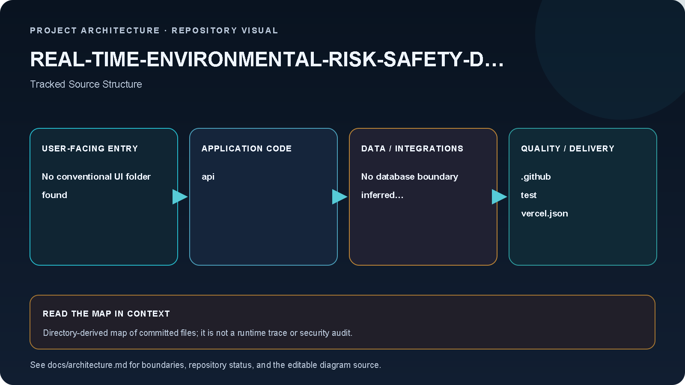
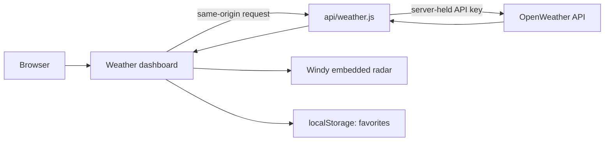

# Environmental Risk & Safety Dashboard

<strong>A responsive weather and outdoor-risk dashboard for checking current conditions, forecast, air quality, UV index, and rain radar.</strong>

**Live link:** [https://instant-forecast.netlify.app/](https://instant-forecast.netlify.app/)

HTML · CSS · JavaScript · OpenWeather · Windy radar

## Project overview

Search for a location or use browser geolocation to load weather conditions. The dashboard adds forecast cards, UV and air-quality indicators, saved favorite locations, theme switching, and a travel planner. Rain radar is embedded from Windy.

## Architecture

[Architecture notes](docs/architecture.md) · [Editable SVG](docs/images/real-time-environmental-risk-safety-dashboard-architecture.svg)

The OpenWeather key is read by the serverless function from `OPENWEATHER_API_KEY`; it is no longer embedded in browser JavaScript.

## Deploy on Vercel

1. Import this repository into Vercel.
2. Add `OPENWEATHER_API_KEY` in the project's private environment-variable settings. The UV index uses OpenWeather One Call API 3.0, so the key must have that product enabled.
3. Deploy the project and open the generated URL. The `/api/weather` function proxies the allowed current-weather, forecast, UV, and air-pollution requests.

Do not add the key to `index.html`, `script.js`, a `NEXT_PUBLIC_` variable, or Git. The previous key was present in repository history; rotate it with OpenWeather before relying on the new deployment.

## Run locally

Install the Vercel CLI and run `vercel dev` from this repository. Put `OPENWEATHER_API_KEY=your_key` in an ignored `.env.local` file at the project root. The static page uses the local `/api/weather` function, so opening `index.html` directly will not provide live API data.

## Features

- City search and browser location lookup
- Current temperature, feels-like temperature, humidity, wind, and visibility
- Forecast cards and a rain radar embed
- UV and air-quality readings when the provider returns data
- Favorite locations saved in this browser
- Theme toggle and a date/time-based outdoor planning panel

Weather feeds can be delayed or unavailable. The dashboard is an informational prototype, not an emergency warning system or a substitute for official local advisories.

The serverless weather proxy accepts only the documented actions, validates coordinates, keeps the provider key server-side, and times out an upstream request after 10 seconds. UV data comes from One Call API 3.0; the retired legacy UV endpoint is not used. Run `npm test` for the proxy's input and error-path checks; no frontend build step is needed for this static dashboard.

## Project structure

- `index.html` — dashboard markup
- `style.css` — responsive theme and layout
- `script.js` — browser interactions and same-origin API requests
- `api/weather.js` — server-side OpenWeather proxy
- `vercel.json` — response security headers
